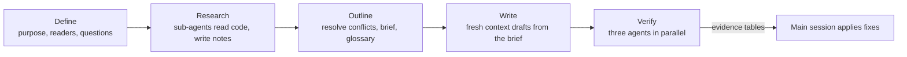

<div align="center">


# doc-writer

**An Agent Skill that writes and reviews formal Chinese documents from what your project actually does**

[](LICENSE)
[](skills/doc-writer/SKILL.md)
[](https://agentskills.io)
[](#installation)
[](https://github.com/blankhoney/doc-writer/stargazers)

**English** · [简体中文](README.zh-CN.md)

[Installation](#installation) · [Usage](#usage) · [What it writes](#what-it-writes) · [How it works](#how-full-mode-works) · [Documentation](#documentation)

</div>

---

doc-writer has the agent read your code, configuration, and recorded decisions before it writes any of 12 document types: PRDs, technical designs, API docs, ADRs, runbooks, test reports, READMEs, and more. The doc-lint scanner then flags boilerplate and layout problems, and the model decides which flags are real.

It follows the [Agent Skills](https://agentskills.io) specification, so Claude Code, Codex, and any other agent that can read files can use it. The rules, writing guides, and documentation are in Chinese.

| Feature | What it means |
|---|---|
| Facts from the project | Code, configuration, recorded decisions, and execution logs back each claim. Missing information becomes a placeholder, and the agent tells you in chat what is missing |
| Per-type writing guides | Six guides (product, tech, reference, ops, test, marketing), each with standard sections and anti-patterns |
| Two modes | Lightweight mode writes and self-checks; full mode has the main session orchestrate research, drafting, and three checks |
| Stays out of the way | It does not activate for research notes, session handoffs, to-do updates, code comments, commit messages, or chat answers |

## Installation

Install with the [skills](https://github.com/vercel-labs/skills) CLI. It detects the agents on your machine (Codex, Cursor, Gemini CLI, GitHub Copilot, Claude Code, and others) and puts the skill in each one's skills directory:

```bash
npx skills add blankhoney/doc-writer        # current project
npx skills add blankhoney/doc-writer -g     # personal directory, all projects
```

Without Node, copy `skills/doc-writer/` into your agent's skills directory and keep the directory name `doc-writer` (it must match `name` in `SKILL.md`). Your agent's documentation gives the directory location.

Open a new session afterwards and check that the agent lists `doc-writer`. A session that already loaded an older version may keep using it, so open a new session after updating too.

doc-lint needs Python 3.9 or later and uses only the standard library. Without Python, the agent still writes and checks the document and says in its delivery summary that the scan did not run.

## Usage

In a session opened in your project, describe the document you want. Clients with slash commands also accept a leading `/doc-writer`.

```text
Use doc-writer in lightweight mode: based on this project's README.md, write a Chinese quick-start guide for engineers joining the project. Save it to docs/quickstart.md.
```

The agent saves a file only when your request names a path. Otherwise it returns the text in chat.

<details>
<summary>More example requests</summary>

Return the text in chat only:

```text
Use doc-writer in lightweight mode: using the following material, write a Chinese code contribution guide for project contributors. Return the text in chat only: developers create a feature branch and submit a pull request; each pull request must explain the purpose of the changes; a maintainer merges it after automated tests pass and one maintainer approves.
```

Review without rewriting (full mode with three independent checks; add "lightweight" for a quick style pass):

```text
Use doc-writer: review docs/architecture.md for structure, terminology, and accuracy against the implementation. List specific locations and suggested changes. Do not modify any files.
```

</details>

### Two modes

| Mode | When | What runs |
|---|---|---|
| Lightweight (default) | The agent picks up the skill on its own, or you say "lightweight" | Reads the shared rules and the writing guide for the document type; reads the code first when the document covers code behavior; checks diagrams, style, and layout, then runs doc-lint. Open questions are asked in chat |
| Full | You name doc-writer (or type `/doc-writer`) and ask it to write, review, or finalize, or you say "full process", "final", or "定稿" | Five-stage orchestration with three independent checks |

Naming the skill only to write a short document, such as a README or release notes, stays lightweight.

The mode lasts for the session until you switch. You can discuss a design in lightweight mode and switch to full once it is settled; notes and drafts carry over.

### When it activates

| Activates | Does not activate |
|---|---|
| Writing or completing PRDs, technical designs, ADRs, API docs, runbooks, test plans and reports, product introductions, READMEs, release notes | The task already specifies a format or template, or names another skill |
| Reviewing an existing document of these types | Research notes, cards, work logs, session handoffs, status and to-do updates |
| Writing a proposal for you or reviewers to read | Code changes, comments, and commit messages; answering questions in chat |

If you name the skill, it runs even for the cases in the right column.

## What it writes

| Task | Document type |
|---|---|
| Define feature goals and acceptance conditions | PRD |
| Propose a design and explain trade-offs | Technical design (architecture proposal or implementation design) |
| Describe API usage | API documentation |
| Explain what a release changes for users | Changelog |
| Report test results or plan testing | Test report |
| Document deployment and on-call operations | Deployment guide / Runbook |
| Record an existing decision | ADR |
| Teach a skill or walk through a task | Tutorial, How-to |
| Look up a contract or understand a mechanism | Reference, Explanation |
| Write a repository front page | README |

A document often mixes fragment types: a README opens with a product introduction, and its setup section is a procedure. The agent picks a guide per fragment from `skills/doc-writer/references/writing/`: `product`, `tech`, `reference`, `ops`, `test`, or `marketing`.

## How full mode works

The main session acts as the lead. It defines the task, outlines, and applies fixes, while sub-agents read code, draft, and verify. Each stage writes its output to files and the next stage reads only those files, so a long document does not fill the main session's context.



1. **Define.** Record the purpose, readers, questions to answer, and scope, and keep your original wording line by line.
2. **Research.** Sub-agents read the code and write topic notes covering the call chain, storage, defaults, failure branches, and a worked example, with `file:line` references.
3. **Outline.** Verify the conflicts and inferences the outline relies on, then write the brief and a glossary that defines each ambiguous term once.
4. **Write.** A writing agent in a fresh context reads only the notes its chapters cite and rechecks the source before describing each mechanism.
5. **Verify.** Three agents without the writing context check facts and consistency, scope and requirements, and style and layout, and write evidence tables only. The main session applies the fixes and updates every occurrence in tables, diagrams, and examples.

<details>
<summary>How the model and doc-lint divide the work</summary>

doc-lint flags boilerplate, vague modifiers, and Chinese formatting issues from the G1 table, plus layout candidates such as overlong paragraphs and bold body text. It only locates candidates; the model decides which are real. A hit is not automatically a violation, and zero hits do not mean the document passes. The unslop checklist covers the habits a word list cannot catch.

See [architecture and writing methods](docs/guide/architecture.md) (Chinese) for the full mechanism and [SOURCES.md](SOURCES.md) for where the writing rules come from.

</details>

## When not to use it

- You are writing English documents. The rules, word lists, and scanner target Chinese.
- Your agent cannot read local files. Rules and writing guides are read from disk on demand.
- You want it to commit or publish on its own. Saving files, running the deployment steps a document describes, and committing code each need your separate permission.

## Documentation

The guides below are in Chinese.

| Document | Contents |
|---|---|
| [Documentation entry point](docs/guide/README.md) | Installation layout, first use, and navigation |
| [Usage guide](docs/guide/usage.md) | Supplying material, saving, revising, reviewing only, running doc-lint standalone |
| [Architecture and writing methods](docs/guide/architecture.md) | The five stages, writing guides, verification, and how the model and doc-lint divide the work |

## Contributing

Issues and pull requests are welcome. Before changing rules, writing guides, or the scanner, read the [contributing guide](CONTRIBUTING.md) (Chinese), which covers the test command and doc-lint.

## Star history

<a href="https://www.star-history.com/#blankhoney/doc-writer&Date">
  <picture>
    <source media="(prefers-color-scheme: dark)" srcset="https://api.star-history.com/svg?repos=blankhoney/doc-writer&type=Date&theme=dark" />
    <source media="(prefers-color-scheme: light)" srcset="https://api.star-history.com/svg?repos=blankhoney/doc-writer&type=Date" />
    
  </picture>
</a>

## License

The project's code, rules, and documentation are licensed under the [MIT License](LICENSE). The unslop checklist is adapted from unslop (Lauren Tan, MIT); see [SOURCES.md](SOURCES.md).
